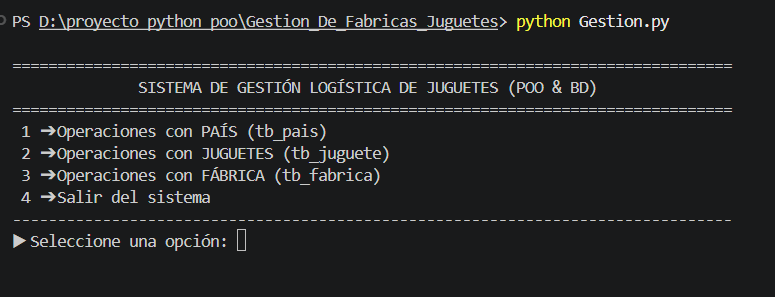
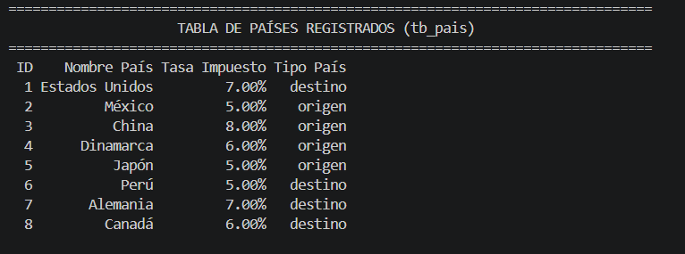
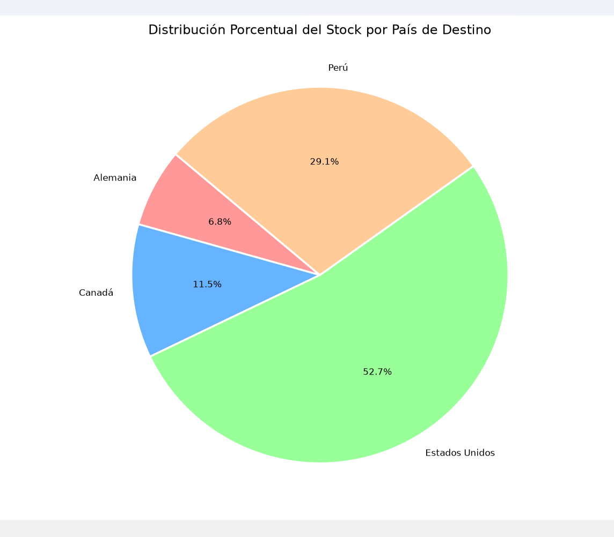
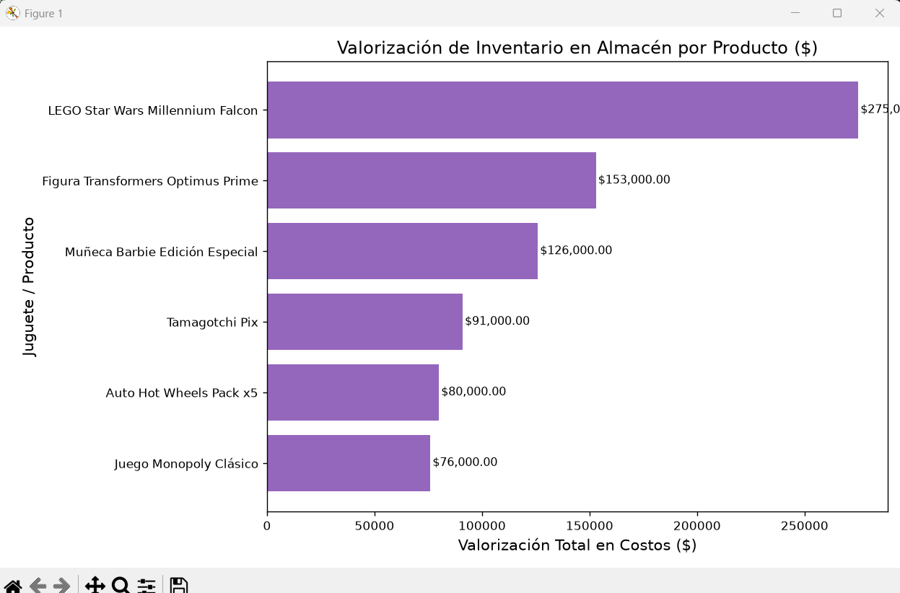

# 🧸 Sistema de Gestión Logística de Juguetes (POO & Excel Relacional)

Sistema en Python para la gestión logística y análisis financiero de una empresa multinacional de juguetes. Implementa arquitectura POO, modelo relacional con claves primarias/foráneas en Excel y reportes estadísticos interactivos.

---

## 🚀 Tecnologías
* **Python** (POO y validación robusta de excepciones)
* **Pandas & NumPy** (Modelo relacional y operaciones vectoriales)
* **Matplotlib** (Visualizaciones analíticas de inventario y exportación)
* **Openpyxl** (Persistencia de datos en Excel)

---

## 🗂️ Modelo Relacional (`Gestion.xlsx`)
El sistema gestiona 3 entidades interconectadas manteniendo integridad referencial:
* **`tb_pais`**: Países de origen/destino y tasas impositivas (**PK:** `id_pais`).
* **`tb_fabrica`**: Plantas de producción (**PK:** `id_fabrica`, **FK:** `id_pais_origen`).
* **`tb_juguete`**: Productos en stock (**PK:** `id_juguete`, **FK:** `id_fabrica`, **FK:** `id_pais_destino`).

---

## 📸 Demostración del Sistema

### 1. Interfaz de Consola y Menús
<p align="center">
  
</p>

### 2. Tablas y Reportes Relacionales
<p align="center">
  
</p>

### 3. Reportes Gráficos (Matplotlib)
<p align="center">
  
</p>

<p align="center">
  
</p>

---

## 💻 Ejecución Local

1. Instalar dependencias:
   ```bash
   pip install pandas numpy openpyxl matplotlib
